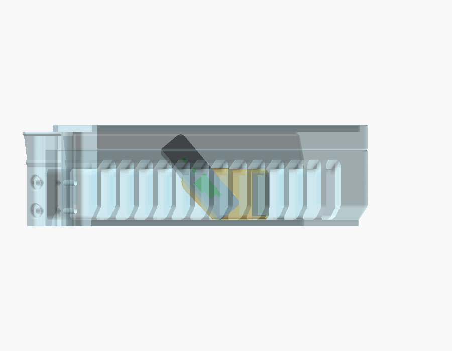
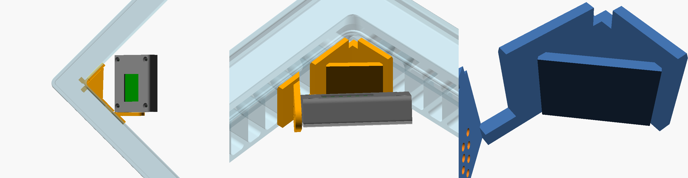
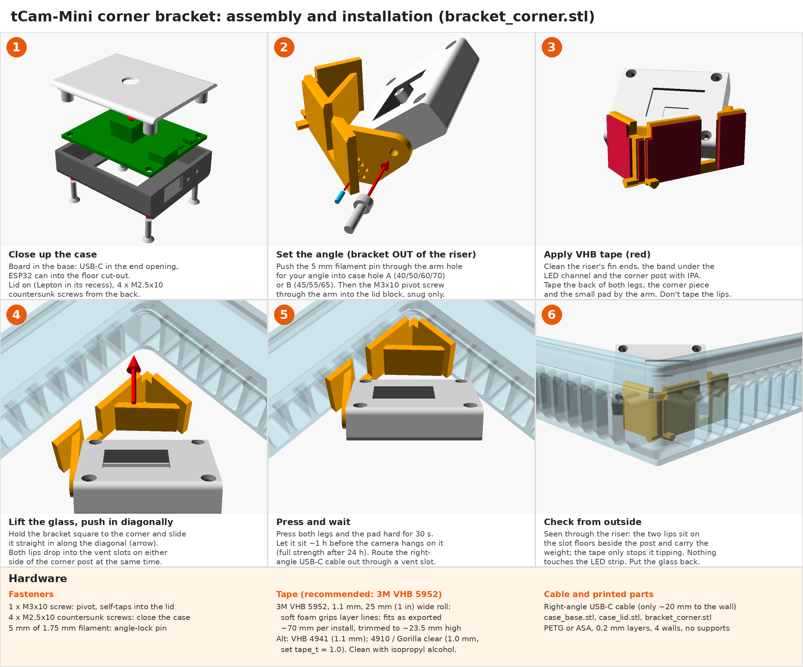

# tCam-Mini mount for a Bambu Lab P1S with the Vented LED Riser

This is a case and tilting mount for a **tCam-Mini Rev 4** thermal camera (FLIR Lepton 3.5). The camera sits inside the riser near the **front-left corner** and looks across the build plate.

It's made for the MakerWorld **"Vented LED Riser"** (`LEDVentedRiser.3mf`, 46 mm). The bracket's tab slides into the vent slot of the **FrontLeft** piece that runs from x 31.75 to 40.75 mm in that piece's own model frame. That's the fourth vent slot from the corner on the piece's **longer arm** (about 201 mm; the other arm is about 187 mm).

The camera stays under the glass and above the printer's top edge at every angle, so it never enters the toolhead's space. These numbers come from the riser's mesh, not estimates:
- Lowest point: 2.8 mm above the printer top.
- Highest point: 1.2 mm below the glass.

## Parts (`stl/`)

| File | Qty | Print orientation |
|---|---|---|
| `case_base.stl` | 1 | as exported (back face down) |
| `case_lid.stl` | 1 | as exported (lens face down) |
| `bracket.stl` | 1 | as exported (installed orientation, flat bottom). Tab version. |
| `bracket_tape.stl` | (alt.) | as exported. VHB version: print this **instead of** `bracket.stl`. |
| `bracket_corner.stl` | (alt.) | as exported. VHB corner-V version: print this **instead of** `bracket.stl`. |

Print in **PETG or ASA**: the enclosed chamber gets warm, and PLA can creep. Use 0.2 mm layers, 4 walls, and no supports.

## Hardware

- 1 × M3×10 screw for the pivot. It self-taps into the lid's pivot block, through the base's end wall.
- 4 × M2.5×10 countersunk screws for the case, through the back, the PCB, and into the lid posts.
- A 5 mm piece of 1.75 mm filament for the angle-lock pin.
- A **right-angle USB-C cable**: the USB end of the case is only 20 mm from the riser's left wall. Route the cable out through a vent slot.

## Assembly

1. Put the tCam-Mini in the base with the USB connector in the large end opening and the ESP32 can poking into the floor cut-out. Fit the lid, which holds the Lepton in its recess, and fasten it with the four M2.5 screws.
2. Set the angle **with the bracket out of the riser**: push the pin through the matching arm hole into the case (see the table below). Then screw the M3 pivot through the arm into the case's end. Tighten it until the case is snug, not locked.
3. Lift the glass and slide the bracket's tab outward into the vent slot until the plate sits on the fins. Put the glass back.

### VHB tape version (`bracket_tape.stl`)

This version replaces the tab with a 37.5 mm pad stuck to the inside of the front wall. A short lip reaches 4 mm into the same vent slot and rests on its floor, so the **lip carries the weight and the tape only keeps the bracket from tipping**.

- **Where the tape bonds:** the pad leaves a 1.1 mm gap for the tape, matched to **3M VHB 5952 (recommended)**: its soft foam conforms to printed layer lines. For 1.0 mm tape such as 3M 4910, set `tape_t` in the .scad and re-export.
  - About 350 mm² bonds: the fin ends between the vents, plus the solid band just below the LED channel.
  - The pad's top edge stops 1.3 mm below the ledge the LED strip sits on, so it never touches the strip.
- **Applying it:** cover the whole back of the pad with tape. The parts over the vent openings just won't stick.
  - Clean the fin ends and the band under the LED channel with isopropyl alcohol.
  - Set the angle and fit the camera first (step 2 above).
  - Slide the lip into the slot, press the pad hard for 30 s, and wait about an hour before letting the camera hang on it. VHB reaches full strength after about 24 h.
- **Changing the angle:** you have to peel the pad off and use new tape, because the pin holes face the wall. If you'll change angles often, use the tab version.

### VHB corner version (`bracket_corner.stl`), the strongest taped option

Step-by-step assembly and installation:

Printable version (US Letter, landscape): [corner_assembly.pdf](docs/corner_assembly.pdf)

This version is a closed triangle that fits the front-left corner, with one leg on each wall and a diagonal brace between them. A low rail along the front wall connects it to the pivot arm, which keeps its own small taped pad. The camera stays in the same spot as in the other versions; nothing else fits between the printer top and the glass.

- **Tape area:** about 600 mm² across both walls: fin ends, the solid band under the LED channel, and the corner post's face. Because it's bonded to two walls at 90°, the camera's weight mostly loads the tape in shear, not peel.
- **Weight:** two short lips rest on the floors of the vent slots on each side of the corner post, and they carry the weight.
- **LED strip:** the pad stays below the LED strip on both walls. The corner part stops at z = 0, where the strip and the post's flared top edges begin.
- **Fitting it:** tape the back of both legs and the arm's pad. Then push the bracket **diagonally into the corner**. The two lips slide into their slots together; the slots have room for the 3.5 mm of sideways travel. Press both legs hard.
- **Checks:** at every tilt it clears the riser and the case. The lips have 0.25 mm clearance. The legs leave a 1.1 mm tape gap, and are chamfered at the bottom of the post for the fillet at its foot. A step-by-step simulation of the diagonal push-in found no interference.

### Angle stops (tilt below horizontal)

The arm has two rows of holes:

| Stop | Arm hole | Case hole |
|---|---|---|
| 40°, 50°, 60°, 70° | outer row (4 holes), lowest = 40° | **A**, the outer of the two small holes in the case end |
| 45°, 55°, 65° | inner row (3 holes), lowest = 45° | **B**, the inner one |

### Which angle to use

The table shows estimated plate coverage, in % of the plate in view. H is the distance from the printer's top edge down to the plate. It's about 115 mm with the bed at the top (start of a print) and about 370 mm at the bottom.

| Tilt | H 115 | 150 | 200 | 250 | 300 | 370 |
|---|---|---|---|---|---|---|
| 40° | 82 | 82 | 80 | 72 | 61 | 42 |
| 45° | 79 | **87** | 87 | 83 | 76 | 63 |
| 50° | 63 | 85 | 92 | 90 | 86 | 79 |
| 55° | 45 | 71 | **93** | **96** | 94 | 90 |
| 60° | 33 | 54 | 84 | **97** | **98** | 97 |
| 65° | 24 | 40 | 67 | 89 | 98 | **100** |
| 70° | 18 | 29 | 50 | 73 | 89 | 99 |

**50–55° is the best all-round setting.** The coverage figures assume:
- the plate's front-left corner is about 45 mm in from the riser's front and left inner faces;
- the Lepton's wide (57°) axis runs along the board's long (47 mm) side;
- nothing blocks the view, though in practice the toolhead and gantry block part of it.

## Notes

- **World frame:** the model is designed in the riser FrontLeft piece's own frame.
  - In `tcam_p1s_mount.scad`, `part = "assembly"` with `show_riser = true` and `riser_stl = <FrontLeft STL>` shows the fit.
  - `case_at` and `bracket_world` export the parts in place for collision checks.
- **Collision checks** were run against the actual riser mesh at every stop (40–70°):
  - no overlaps;
  - tab-to-slot gap 0.2–0.25 mm;
  - case-to-arm gap 0.3 mm;
  - case-to-riser gap at least 5 mm.
- **Before the first print with the camera installed,** move the toolhead to the front-left corner by hand with the motors off. Confirm it stays below the printer's top edge.
- The case dimensions follow Dan Julio's tCam-Mini Rev 4 drawings. The `tcam_mini.scad` board model from `../tCam` is used only for the preview.

## License

MIT, see [LICENSE](LICENSE). The Vented LED Riser is a separate MakerWorld model by its own author and is not included here.
